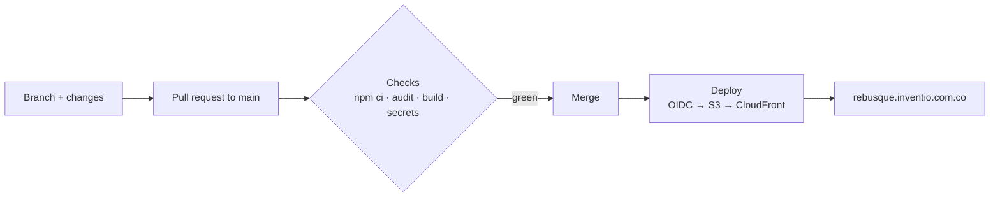

<p align="center">🌍 <a href="README.md">Español</a> | <strong>English</strong></p>

<p align="center">
  
</p>

<h1 align="center">Rebusque</h1>

<p align="center">
  <strong>Survive the streets of a Colombian city: scavenge, sell, build your shelter and sleep to save.<br>In the browser, free, nothing to install.</strong>
</p>

<p align="center">
  <a href="https://rebusque.inventio.com.co">Play now</a> &middot;
  <a href="#how-to-play">How to play</a> &middot;
  <a href="#quick-start">Quick start</a> &middot;
  <a href="#architecture">Architecture</a> &middot;
  <a href="#documentation">Documentation</a> &middot;
  <a href="CONTRIBUTING.md">Contributing</a> &middot;
  <a href="SECURITY.md">Security</a>
</p>

<p align="center">
  <a href="https://rebusque.inventio.com.co"></a>
  <a href="https://github.com/JuanRojasDev/rebusque/actions/workflows/verificacion.yml"></a>
  <a href="https://github.com/JuanRojasDev/rebusque/actions/workflows/despliegue.yml"></a>
  
  
  <a href="LICENSE"></a>
  
  <a href="CONTRIBUTING.md"></a>
</p>

---

Rebusque (Colombian slang for *getting by however you can*) is an isometric urban-survival sim. You arrive on a city block at dusk with empty hands and have to make a living: dig through trash bags, sell the material at the recycling center, grab food at the corner store, build a *cambuche* (a makeshift shelter) under the overpass, and sleep to save your game. Night brings rain, sodium street lights and traffic; the next day, another chance.

The game is in Spanish; this page explains it in English.

<p align="center">
  <a href="https://rebusque.inventio.com.co"></a><br>
  <sub>The title screen, captured from the live game. Everything on screen is generated in code: no third-party images or models.</sub>
</p>

## Why Rebusque?

- **Playable in seconds.** Open the link from TikTok or WhatsApp and you are on the street. No downloads, no accounts.
- **Built for phones.** Tap the ground to walk; tap a trash bag, a shop or a stopped car to use it. On a PC it works with the mouse or WASD.
- **A block that feels alive.** Day, dusk and night; rain that soaks you and makes you sick; traffic lights with cars that brake and honk.
- **Lightweight.** About 200 KB compressed, no bloom or heavy effects, with quality presets for mid-range phones.
- **Respectful.** It portrays a hard reality without mocking anyone ([tone guide](01-vision/tono-y-responsabilidad.md), in Spanish).

## What's new

**v0.1, the first playable block.**

- **A full survival loop:** scavenge → sell → eat → build → sleep and save, with a five-step tutorial.
- **Five needs** shown as traffic-light bars: hunger, sleep, hygiene, health and **craving** (*vicio*). If craving runs out you go into withdrawal: you walk slower and lose health.
- **Character creator:** a rotatable 3D preview, six categories (identity, body, face, hair, clothes, extras), a name, a backstory and a *Random* button.
- **GPS map:** pick a destination and the route shows up on the map, the minimap and the ground; it can also walk you there.
- **A shelter built piece by piece:** cardboard base, tarp roof, plank walls, mattress, can stove and candle.
- **Continuous deployment:** every merge to `main` goes live at `rebusque.inventio.com.co` automatically.

## How to play

| Step | What you do | Where |
|---|---|---|
| 1 | Search trash bags: cardboard, plastic, cans, scrap and, with luck, copper | Sidewalks and alleys |
| 2 | Sell the material by weight | Recicladora El Progreso (recycling center) |
| 3 | Buy food and eat it from your sack | Tienda La Esquinita (corner store) |
| 4 | Collect 8 cardboard and build your shelter | Under the overpass |
| 5 | Sleep: that is how the game saves | Your *cambuche* |

**Controls**

| Action | Phone | PC |
|---|---|---|
| Walk | Tap the ground | Click the ground or <kbd>W</kbd> <kbd>A</kbd> <kbd>S</kbd> <kbd>D</kbd> |
| Use something | Tap the bag, place or car | Click it or <kbd>E</kbd> |
| Run | Run button | <kbd>Shift</kbd> |
| Rotate view | On-screen arrows | <kbd>Q</kbd> / <kbd>R</kbd> |
| Zoom | Pinch | Mouse wheel |
| Map / sack / pause | HUD buttons | <kbd>M</kbd> / <kbd>I</kbd> / <kbd>Esc</kbd> |

## Quick start

Requires **Node.js 20 or newer**.

```bash
git clone https://github.com/JuanRojasDev/rebusque.git
cd rebusque/juego-web
npm ci --ignore-scripts      # pinned dependencies, no install scripts
npm run dev                  # http://localhost:5173
```

```bash
npm run build                # builds juego-web/dist
npm run preview              # serves the build like production
```

## Architecture

| Piece | Technology | Why |
|---|---|---|
| Rendering | [three.js](https://threejs.org) r186, isometric orthographic camera | Stable WebGL on phones and PCs |
| Look | Lambert shading + depth outline + FXAA | Illustrated-diorama style, cheap to draw |
| Build | [Vite](https://vite.dev) 8 | Single bundle, hashed assets |
| Icons and type | [Lucide](https://lucide.dev), [Overpass](https://fonts.google.com/specimen/Overpass) | Colombian road-sign language in the HUD |
| Saving | Browser `localStorage`, versioned with migration | No backend or accounts in v0.1 |
| Audio | Synthesized with WebAudio | Zero audio files |
| Hosting | Private S3 + CloudFront with OAC, HTTPS (ACM) | Cheap, fast, serverless |

```text
juego-web/src
├── engine.js            rendering, quality presets, outline
├── world/               city, traffic, atmosphere and weather, props, GPS route
├── player/              character, appearance, controls, navigation (A*)
├── game/                rules: needs, economy, objectives, saving
└── ui/                  HUD, menus, minimap, big map, character creator
```

## Workflow and deployment



- `main` is protected: it only changes through pull requests with green checks, and force-pushes are blocked.
- GitHub reaches AWS through **OIDC**, with short-lived credentials and no stored keys. The role can only upload to the game's bucket and invalidate its distribution.
- GitHub Actions are pinned by commit. Dependabot proposes weekly updates, only for versions published at least two weeks ago.

## Documentation

The design documents are in Spanish.

| Guide | Contents |
|---|---|
| [Vision and design](01-vision/GDD.md) | Concept, pillars, core loop, systems |
| [Tone and responsibility](01-vision/tono-y-responsabilidad.md) | Portraying street life without mocking anyone |
| [What the community asked for](02-investigacion/voz-de-la-comunidad.md) | Ideas ranked by votes |
| [Art and realism](03-arte-y-realismo/pipeline-realismo.md) | Art pipeline for the desktop version |
| [Engine](04-tecnologia/decision-de-motor.md) · [AWS](04-tecnologia/arquitectura-aws.md) | Technical decisions and infrastructure |
| [Roadmap](05-produccion/roadmap.md) · [Checklist](05-produccion/checklist.md) | Phases and open tasks |

## Roadmap

- [x] Playable block: scavenging, selling, shop, shelter, saving
- [x] Day, dusk and night, rain and traffic lights
- [x] Character creator and GPS map
- [x] Continuous deployment to `rebusque.inventio.com.co`
- [ ] Cloud saves and accounts
- [ ] Police, other street dwellers and territory
- [ ] Juggling at the traffic light and car watching
- [ ] Talent tree and full crafting
- [ ] Desktop version in Unreal Engine 5

## Contributing

Ideas and contributions are welcome. Read [CONTRIBUTING.md](CONTRIBUTING.md) (in Spanish) for the workflow and the rules: original art only, nothing copied from other games, a respectful tone. Please follow the [code of conduct](CODE_OF_CONDUCT.md). To suggest something, open an [issue](https://github.com/JuanRojasDev/rebusque/issues/new/choose).

## Contributors

Rebusque is built by the community ❤️: thank you to everyone who has contributed. The full list is in [CONTRIBUTORS.md](CONTRIBUTORS.md).

<a href="https://github.com/JuanRojasDev/rebusque/graphs/contributors">
  
</a>

## Security

If you find a vulnerability, do not open a public issue; report it privately as described in [SECURITY.md](SECURITY.md).

## License and trademark

The **code** in this repository is under the [MIT license](LICENSE): you can use, study and modify it.

The **name "Rebusque"**, the **logo** and the **design documents** (folders `01-vision` to `06-legal-y-publicacion`) are not covered by that license; all rights are reserved. Details are in [MARCA.md](MARCA.md).
