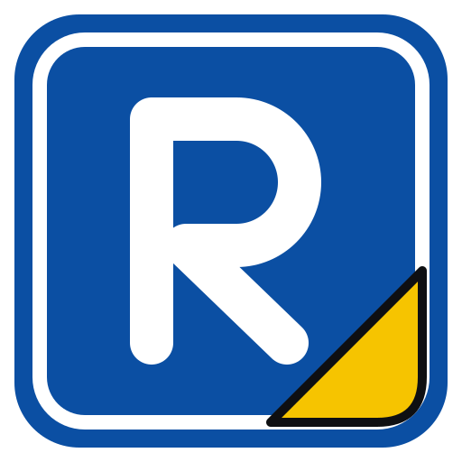
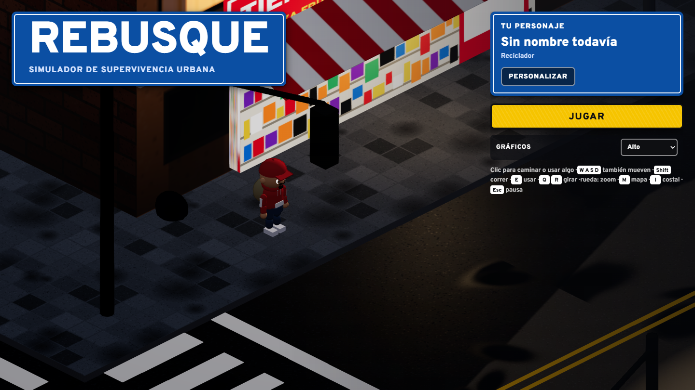
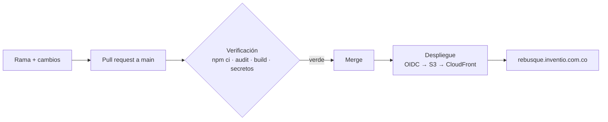

<p align="center">🌍 <strong>Español</strong> | <a href="README.en.md">English</a></p>

<p align="center">
  
</p>

<h1 align="center">Rebusque</h1>

<p align="center">
  <strong>Sobrevive la calle de una ciudad colombiana: recicla, vende, arma tu cambuche y duerme para guardar.<br>En el navegador, gratis y sin instalar nada.</strong>
</p>

<p align="center">
  <a href="https://rebusque.inventio.com.co">Jugar ahora</a> &middot;
  <a href="#cómo-se-juega">Cómo se juega</a> &middot;
  <a href="#inicio-rápido">Inicio rápido</a> &middot;
  <a href="#arquitectura">Arquitectura</a> &middot;
  <a href="#documentación">Documentación</a> &middot;
  <a href="CONTRIBUTING.md">Contribuir</a> &middot;
  <a href="SECURITY.md">Seguridad</a>
</p>

<p align="center">
  <a href="https://rebusque.inventio.com.co"></a>
  <a href="https://github.com/JuanRojasDev/rebusque/actions/workflows/verificacion.yml"></a>
  <a href="https://github.com/JuanRojasDev/rebusque/actions/workflows/despliegue.yml"></a>
  
  
  <a href="LICENSE"></a>
  
  <a href="CONTRIBUTING.md"></a>
</p>

---

Rebusque es un simulador de supervivencia urbana en vista isométrica. Llegas a una cuadra con las manos vacías al atardecer y te toca rebuscarte la vida: buscar en las bolsas de basura, vender el material en la recicladora, comer algo en la tienda de la esquina, armar un cambuche bajo el viaducto y dormir para guardar la partida. La noche trae lluvia, faroles de sodio y tráfico; el día siguiente, otra oportunidad.

<p align="center">
  <a href="https://rebusque.inventio.com.co"></a><br>
  <sub>La pantalla de título, capturada del juego publicado. Todo lo que se ve se genera en código: no hay imágenes ni modelos de terceros.</sub>
</p>

## ¿Por qué Rebusque?

- **Se juega en segundos.** Abres el link desde TikTok o WhatsApp y ya estás en la calle. Sin descargas, sin cuentas.
- **Hecho para el celular.** Tocas el piso para caminar y tocas una bolsa, la tienda o un carro detenido para usarlos. En PC también funciona con mouse o con WASD.
- **Una cuadra que se siente viva.** Día, atardecer y noche; lluvia que te moja y enferma; semáforos con carros que frenan y pitan.
- **Liviano.** Unos 200 KB comprimidos, sin bloom ni efectos pesados, con calidad ajustable para celulares de gama media.
- **Con respeto.** Retrata una realidad dura sin burlarse de nadie ([tono y responsabilidad](01-vision/tono-y-responsabilidad.md)).

## Novedades

**v0.1, la primera cuadra jugable.**

- **Ciclo completo de supervivencia:** reciclar → vender → comer → construir → dormir y guardar, con un tutorial de cinco objetivos.
- **Cinco necesidades** en barras tipo semáforo: hambre, sueño, higiene, salud y **vicio**. Si el vicio se vacía, entras en abstinencia: caminas más lento y pierdes salud.
- **Editor de personaje:** vista 3D que se gira, seis categorías (identidad, cuerpo, cara, pelo, ropa y extras), nombre, origen y botón *Al azar*.
- **Mapa con GPS:** marcas un destino y aparece la ruta en el mapa, en el minimapa y en el piso; también te puede llevar caminando.
- **Cambuche por piezas:** base de cartón, techo de lona, paredes de tablas, colchón, fogón y vela.
- **Despliegue automático:** cada merge a `main` se publica solo en `rebusque.inventio.com.co`.

## Cómo se juega

| Paso | Qué haces | Dónde |
|---|---|---|
| 1 | Buscas en las bolsas de basura: cartón, plástico, latas, chatarra y, con suerte, cobre | Andenes y callejones |
| 2 | Vendes el material al peso | Recicladora El Progreso |
| 3 | Compras comida y te la comes desde el costal | Tienda La Esquinita |
| 4 | Juntas 8 de cartón y armas el cambuche | Bajo el viaducto |
| 5 | Duermes: así se guarda la partida | Tu cambuche |

**Controles**

| Acción | Celular | PC |
|---|---|---|
| Caminar | Tocar el piso | Clic en el piso o <kbd>W</kbd> <kbd>A</kbd> <kbd>S</kbd> <kbd>D</kbd> |
| Usar algo | Tocar la bolsa, el lugar o el carro | Clic encima o <kbd>E</kbd> |
| Correr | Botón de correr | <kbd>Shift</kbd> |
| Girar la vista | Flechas en pantalla | <kbd>Q</kbd> / <kbd>R</kbd> |
| Zoom | Pellizcar | Rueda del mouse |
| Mapa / costal / pausa | Botones del HUD | <kbd>M</kbd> / <kbd>I</kbd> / <kbd>Esc</kbd> |

**Necesidades**

| Necesidad | Baja con… | La subes con… |
|---|---|---|
| Hambre | El paso del tiempo | Empanada, arepa, pan (tienda) o comida sobrada (riesgosa) |
| Sueño | Estar despierto, correr | Dormir en el cambuche, un tinto |
| Higiene | Rebuscar en la basura | Lavarte en la pila del parque (mejor con jabón) |
| Salud | Lluvia, gripa, hambre, abstinencia | Comer bien, dormir bajo techo, acetaminofén |
| Vicio | El paso del tiempo | Un cigarrillo suelto o un tinto |

## Inicio rápido

Requiere **Node.js 20 o superior**.

```bash
git clone https://github.com/JuanRojasDev/rebusque.git
cd rebusque/juego-web
npm ci --ignore-scripts      # dependencias fijadas, sin scripts de instalación
npm run dev                  # http://localhost:5173
```

```bash
npm run build                # genera juego-web/dist
npm run preview              # sirve el build como en producción
```

## Arquitectura

| Pieza | Tecnología | Por qué |
|---|---|---|
| Render | [three.js](https://threejs.org) r186, cámara ortográfica isométrica | WebGL estable en celulares y PC |
| Estilo | Lambert + contorno por profundidad + FXAA | Look de maqueta ilustrada, barato de dibujar |
| Build | [Vite](https://vite.dev) 8 | Bundle único, assets con hash |
| Íconos y letra | [Lucide](https://lucide.dev), [Overpass](https://fonts.google.com/specimen/Overpass) | Señalética vial colombiana en el HUD |
| Guardado | `localStorage` del navegador, versionado y con migración | Sin backend ni cuentas en la v0.1 |
| Audio | WebAudio sintetizado | Cero archivos de audio |
| Hosting | S3 privado + CloudFront con OAC, HTTPS (ACM) | Barato, rápido y sin servidores |

```text
juego-web/src
├── engine.js            render, presets de calidad, contorno
├── world/               ciudad, tráfico, atmósfera y clima, props, ruta del GPS
├── player/              personaje, apariencia, controles, navegación (A*)
├── game/                reglas: necesidades, economía, objetivos, guardado
└── ui/                  HUD, menús, minimapa, mapa grande, editor de personaje
```

## Flujo de trabajo y despliegue



- `main` está protegida: solo cambia por pull request, con la verificación en verde, y no admite force-push.
- GitHub entra a AWS por **OIDC**, con credenciales temporales y sin llaves guardadas. El rol solo puede subir al bucket del juego e invalidar su distribución.
- Las acciones de GitHub están fijadas por commit. Dependabot propone actualizaciones semanales, solo de versiones con al menos dos semanas publicadas.
- Despliegue manual de emergencia: `npm run build` y luego `bash scripts/deploy-aws.sh` (requiere el perfil de AWS local).

## Documentación

| Guía | Contenido |
|---|---|
| [Visión y diseño](01-vision/GDD.md) | Concepto, pilares, ciclo principal, sistemas |
| [Tono y responsabilidad](01-vision/tono-y-responsabilidad.md) | Cómo retratar la calle sin burlarse de nadie |
| [Lo que pidió la comunidad](02-investigacion/voz-de-la-comunidad.md) | Ideas priorizadas por votos |
| [Arte y realismo](03-arte-y-realismo/pipeline-realismo.md) | Pipeline de arte para la versión de escritorio |
| [Personalización](03-arte-y-realismo/personalizacion.md) | Personaje, cambuche y progresión |
| [Motor](04-tecnologia/decision-de-motor.md) · [AWS](04-tecnologia/arquitectura-aws.md) | Decisiones técnicas e infraestructura |
| [Roadmap](05-produccion/roadmap.md) · [Checklist](05-produccion/checklist.md) | Fases y tareas pendientes |
| [Legal y publicación](06-legal-y-publicacion/legal-y-publicacion.md) | Propiedad intelectual, clasificación, tiendas |

## Hoja de ruta

- [x] Cuadra jugable: reciclaje, venta, tienda, cambuche, guardado
- [x] Día, atardecer y noche, lluvia y tráfico con semáforo
- [x] Editor de personaje y mapa con GPS
- [x] Despliegue continuo en `rebusque.inventio.com.co`
- [ ] Guardado en la nube y cuentas
- [ ] Policía, otros habitantes y territorio
- [ ] Semáforo con malabares y cuidar carros
- [ ] Árbol de talentos y crafteo completo
- [ ] Versión de escritorio en Unreal Engine 5 ([decisión](04-tecnologia/decision-de-motor.md))

## Contribuir

Las ideas y los aportes son bienvenidos. Lee [CONTRIBUTING.md](CONTRIBUTING.md) para el flujo de trabajo y las reglas (arte propio, nada copiado de otros juegos, tono respetuoso), y el [código de conducta](CODE_OF_CONDUCT.md). Para proponer algo, abre un [issue](https://github.com/JuanRojasDev/rebusque/issues/new/choose).

## Colaboradores

Rebusque lo construye la comunidad ❤️: gracias a todas las personas que han aportado. La lista completa está en [CONTRIBUTORS.md](CONTRIBUTORS.md).

<a href="https://github.com/JuanRojasDev/rebusque/graphs/contributors">
  
</a>

## Seguridad

Si encuentras una vulnerabilidad, no abras un issue público: repórtala en privado como explica [SECURITY.md](SECURITY.md).

## Licencia y marca

El **código** de este repositorio está bajo la [licencia MIT](LICENSE): puedes usarlo, estudiarlo y modificarlo.

El **nombre "Rebusque"**, el **logo** y los **documentos de diseño** (carpetas `01-vision` a `06-legal-y-publicacion`) no están incluidos en esa licencia y se reservan todos los derechos. Los detalles están en [MARCA.md](MARCA.md).
